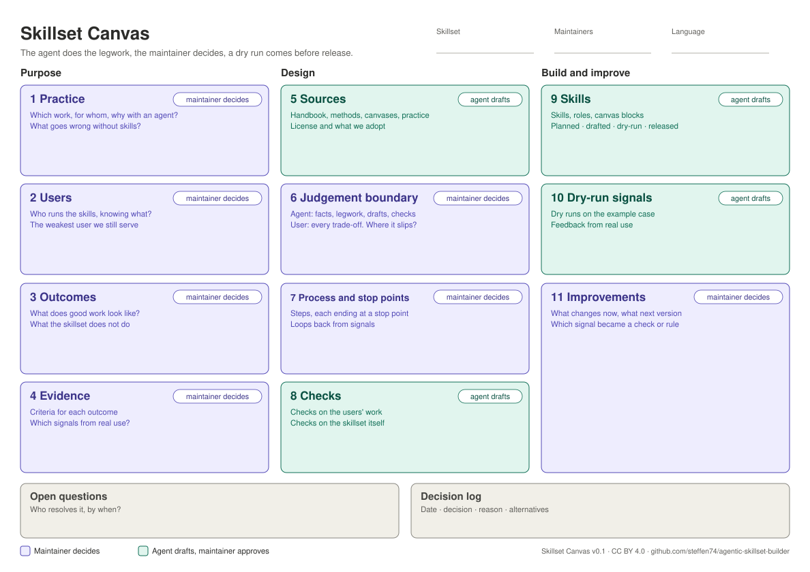

# Agentic Skillset Builder

A canvas, a process and a set of agent skills for building **agentic skillsets**: a canvas, a process and agent skills for one kind of work, used with a coding agent, without handing over the judgement.

> Status: **v0.1.** Worked example: [Agentic Business Model Canvas](examples/agentic-business-model-canvas.md). Distilled from [Agentic Data Science](https://github.com/steffen74/agentic-data-science) and [Agentic Course Creation](https://github.com/steffen74/agentic-course-creation), the first two skillsets of this kind; first real use: an Agentic Business Model Canvas skillset for the opencampus.sh course “Become a Changemaker”.

## Why

The first two skillsets turned out to share a blueprint: a one-page canvas with owners per block, a process with stop points, a fixed set of skill roles (setup, router, grill, plan, produce, check, retro, references), and identical files. Building the third by copying and editing the second works, but:

- each copy drifts: two renderers, two release skills, two slightly different decision logs;
- domain rules slip in that no source supports, because the agent filled a gap;
- a skill reads a file no other skill writes, or a decision the user owns is quietly taken by the agent, and nobody notices until a user hits it;
- the author reads their own skills and sees nothing missing, because they know every missing step.

This repository encodes the habit for building skillsets: **the agent finds facts and does the legwork, the maintainer decides, every domain rule traces to a source, and a dry run on an example case comes before release.**

## The three parts

### 1. The canvas

The [Skillset Canvas](canvas/) is one page with eleven blocks in three columns, **Purpose**, **Design**, **Build and improve**, in the same grammar as the canvases it helps create:

- **Maintainer decides**: practice, users, outcomes, evidence, judgement boundary, process and stop points, improvements.
- **Agent drafts, maintainer approves**: sources, checks, skills, dry-run signals.

In a skillset repository it lives as `design/SKILLSET-CANVAS.md`, next to personas, sources, skill map, decisions and signals: the design record of the skillset.

[](canvas/skillset-canvas.pdf)

### 2. The process

```
setup ──► practice ──► sources ──► domain canvas ──► skill map ──► draft skills ──► dry run ──► review ──► release
               ▲                         ▲                              ▲                          │
               │                         └──────────── fix ◄──── dry-run signals ◄──────────────────┤
               └────────── retro: checks, builder rules, core changes ◄──── real use ◄──────────────┘
```

Each step ends at a **stop point** where the maintainer decides. See [docs/process.md](docs/process.md) and the [principles](docs/principles.md).

### 3. The skills

| Skill | Use it to | Canvas blocks |
|---|---|---|
| `/setup-skillset` | Create the skillset repository (locally, on GitHub or as ZIP), copy the core, scaffold `design/` | all |
| `/ask-builder` | Find out which skill fits your situation | – |
| `/show-canvas` | See a canvas as a page; `live` keeps it updating (core skill, shared by every skillset) | all |
| `/grill-practice` | Get interviewed until practice, users, outcomes, evidence and the judgement boundary are sharp | 1–4, 6 |
| `/map-sources` | Inventory handbook, methods and canvases: license, what each contributes, conflicts | 5 |
| `/design-canvas` | Design the canvas the skillset gives its users: template, guide, printed SVG and PDF | 7 |
| `/to-skill-map` | Process with stop points, skills with roles, shared files, glossary | 7, 9 |
| `/draft-skill` | Draft one skill (or a role group) from its role skeleton, in the skillset’s language | 9 |
| `/dry-run` | Run the skillset on its example case as a persona and report stalls, guesses and overreach | 10 |
| `/review-skillset` | Review on two axes, conventions and practice, then release, fix or hold | 8, 9 |
| `/skillset-retro` | Turn signals into fixes, checks, builder rules and core changes | 10, 11 |
| `/sync-core` | Bring a skillset’s core files up to date, or adopt the core in an existing skillset | – |

Reference skills: `skillset-conventions` (canvas grammar, owners, roles with skeletons, language rule, layout, checks) and `skillset-core` (the shared files and `core_sync.py`). Maintainer skill: `release-skillset`.

## The core

Every skillset built here carries the same **core**: `show-canvas` with `render_canvas.py` (HTML page, printable A4 SVG/PDF, labels in English and German), `check_skillset.py` (convention checks), `release-skillset`, and templates for the decision and signal logs. *Verbatim* files stay identical across skillsets; *adapted* files are translated or renamed. A lock file, `.skillset-core.json`, records what was synced, so `/sync-core` can update verbatim files and show the diff for adapted ones. See [`skills/skillset-core/`](skills/skillset-core/).

## Install

```bash
# Editable copies (any agent; needs Node.js 22.20 or newer)
npx skills@latest add steffen74/agentic-skillset-builder

# Claude Code plugin
claude plugin marketplace add steffen74/agentic-skillset-builder
claude plugin install agentic-skillset-builder@agentic-skillset-builder
```

Then: `/setup-skillset`, and `/ask-builder` whenever you are unsure what comes next.

## Language

The builder is written in English. The skillsets it builds can be in any language: content and conversation in the skillset’s language, skill names, file names and maintainer files in English (see `skills/skillset-conventions/LANGUAGE.md`).

## Credits and licenses

- Skills and scripts: [MIT](LICENSE). Several skills and role skeletons follow the structure of [Matt Pocock’s skills](https://github.com/mattpocock/skills) (MIT); see [NOTICE.md](NOTICE.md). His `writing-for-agents` is the writing guide for every skill, and `grilling` the interview pattern behind every grill skill.
- Canvas and documentation: [CC BY 4.0](LICENSE-docs.md).
