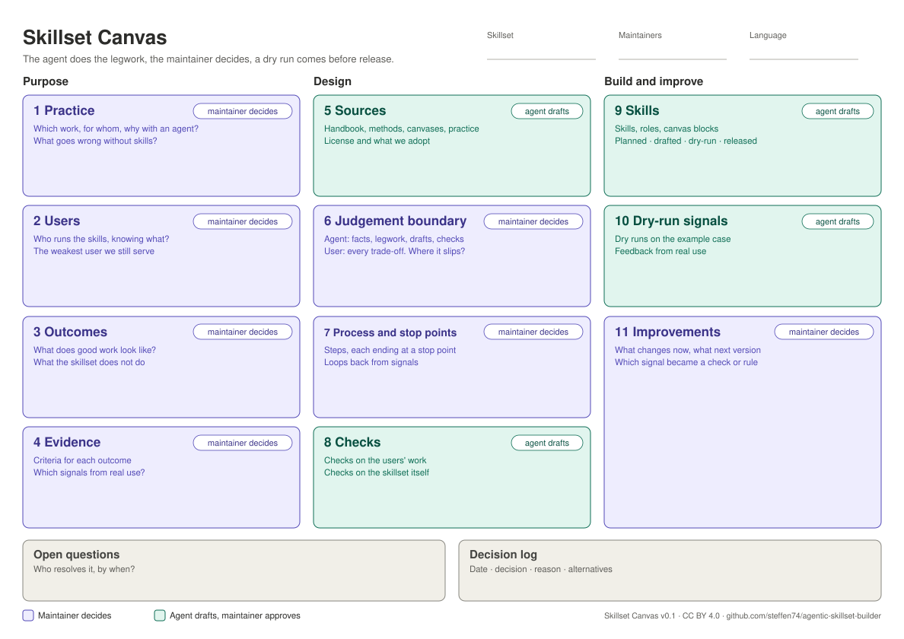

# The Skillset Canvas

One page, eleven blocks, one log, for designing an agentic skillset. Fill it from left to right the first time, then revisit any block when something changes. It uses the same grammar as the canvases of the skillsets it helps build, so the core renderer shows all of them.

- Markdown template: [`SKILLSET-CANVAS.md`](../skills/setup-skillset/templates/design/SKILLSET-CANVAS.md) (copied into `design/` by `/setup-skillset`)

**Owners.** 👤 *Maintainer decides*: the agent may recommend, but the maintainer makes and signs the decision. 🤖 *Agent drafts, maintainer approves*: the agent does the legwork; the maintainer checks and accepts it.

| Data science | Course creation | Skillset | Shared idea |
|---|---|---|---|
| 1 Decision | 1 Change | 1 Practice | Start from what should be different |
| 3 Audiences | 2 Learners | 2 Users | Know who receives the result |
| 2 Questions | 3 Learning goals | 3 Outcomes | Something you can work towards |
| 4 Success | 4 Evidence | 4 Evidence | Fix in advance what counts |
| 5 Data | 5 Constraints | 5 Sources | Factual inventory, agent’s job |
| 6 Known in advance | 6 Assumed knowledge | 6 Judgement boundary | **The boundary**: what crosses it is leakage, a gap, overreach |
| 7 Data decisions | 7 Design decisions | 7 Process and stop points | Judgement calls, logged |
| 8 Checks | 8 Checks | 8 Checks | Invariants before anything counts |
| 9 Experiments | 9 Resources | 9 Skills | What was built |
| 10 Findings | 10 Learner signals | 10 Dry-run signals | What it showed |
| 11 Recommendation | 11 Improvements | 11 Improvements | Close the loop |

---

## Purpose

### 1. Practice 👤
**Purpose:** anchor the skillset in real work and a real failure.
**Prompts:** Which work, in which setting, for whom? What goes wrong today when people do it with an agent and no skills? One concrete failure story.
**Typical mistakes:** starting from a method (“a skillset for the Business Model Canvas”) instead of the work people do with it; a practice so broad no process fits.
**Filled by:** `/grill-practice`

### 2. Users 👤
**Purpose:** design for the people who actually run the skills.
**Prompts:** Role, domain knowledge, agent experience, language, time, setting (course, team, alone). The weakest user the skillset still serves.
**Typical mistakes:** designing for the maintainer; confusing users with beneficiaries; no knowledge state, so the dry run cannot play them.
**Filled by:** `/grill-practice`; details in `design/PERSONAS.md`

### 3. Outcomes 👤
**Purpose:** say what good work looks like when the skillset is used.
**Prompts:** Which artefacts and decisions should users end up with? What does the skillset deliberately not do?
**Typical mistakes:** outcomes that are skills (“a grill skill”) instead of results; nothing excluded.
**Filled by:** `/grill-practice`

### 4. Evidence 👤
**Purpose:** decide in advance how users and maintainers know an outcome is reached.
**Prompts:** Criterion per outcome; where its expected value comes from; which signals from real use count.
**Typical mistakes:** “users like it”; criteria invented after the dry run.
**Filled by:** `/grill-practice`

---

## Design

### 5. Sources 🤖
**Purpose:** a traceable, licensed inventory of the domain logic.
**Prompts:** Handbook, methods, existing canvases, literature, own practice. License of each, what is adopted, adapted, referenced, left out. Conflicts between sources.
**Typical mistakes:** reconstructing a source from memory; assuming “online” means “free to adapt”; rules no source supports.
**Filled by:** `/map-sources`; details in `design/SOURCES.md`

### 6. Judgement boundary 👤
**Purpose:** draw the line between the agent’s work and the user’s decisions.
**Prompts:** For each typical decision in the domain: agent does, agent drafts and user approves, or user decides. Where would an agent cross the line unnoticed?
**Typical mistakes:** “the agent helps with everything”; the agent rating ideas, choosing a target group or a price on its own.
**Filled by:** `/grill-practice`; enforced by stop points and `/dry-run`

### 7. Process and stop points 👤
**Purpose:** the domain process as steps, each ending at a decision, and the canvas users work with.
**Prompts:** Which steps, in which order, with which loops? Where does each step stop for the user? Which canvas do users fill?
**Typical mistakes:** steps without a stop point; a domain canvas copied field by field without owners or checks.
**Filled by:** `/design-canvas`, `/to-skill-map`; details in `design/SKILL-MAP.md`

### 8. Checks 🤖
**Purpose:** invariants for the users’ work and for the skillset itself.
**Prompts:** Domain checks with their expected values; convention checks (`check_skillset.py`); dry run before release.
**Typical mistakes:** reading the skills as the check; checks without an independent expected value.
**Filled by:** `/to-skill-map`, `/review-skillset`, `/skillset-retro`; rules in `skillset-conventions`

---

## Build and improve

### 9. Skills 🤖
**Purpose:** a visible map of the skills and their state.
**Prompts:** Skill, role, canvas blocks, files, status (planned, drafted, dry-run, released), adapted from.
**Typical mistakes:** a skill nobody needs; a file read but never written; a router that misses skills.
**Filled by:** `/to-skill-map`, `/draft-skill`, `/review-skillset`

### 10. Dry-run signals 🤖
**Purpose:** what the skillset actually did for a user.
**Prompts:** Stalls, guesses, overreach, friction and drift from dry runs; issues and retros from real use.
**Typical mistakes:** dry runs where the runner reads `design/`; fixing findings without asking why no check caught them.
**Filled by:** `/dry-run`, `/skillset-retro`; log in `design/SIGNALS.md`

### 11. Improvements 👤
**Purpose:** close the loop for this skillset, the builder and the core.
**Prompts:** What changes now, what in the next version? Which signal became a check, a builder rule or a core change?
**Typical mistakes:** fixing the skill but not the skeleton that produced the problem.
**Filled by:** `/skillset-retro` drafts; the maintainer decides

---

## Open questions and decision log

Open questions name who resolves them, by when. Decisions go to `design/DECISIONS.md` with date, reason, alternatives and canvas block.
